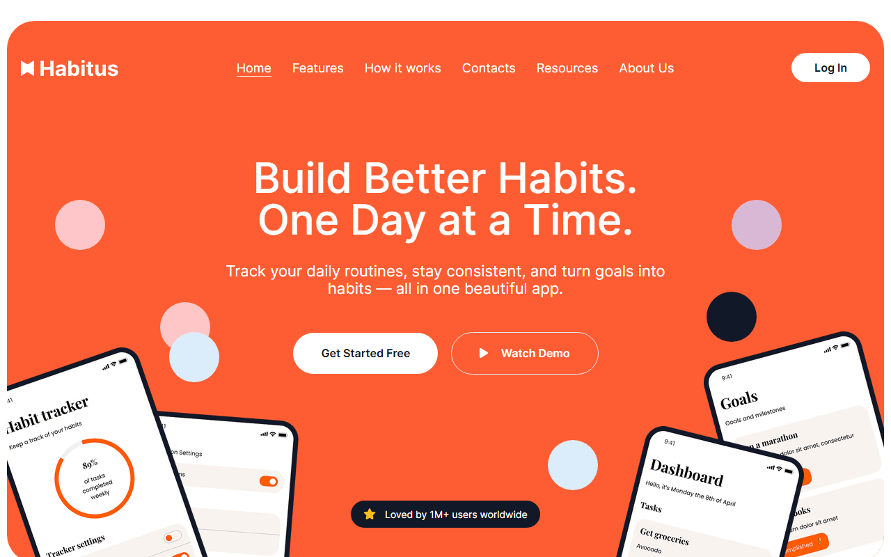

# Habitus — Habit Tracker App Landing Page

A responsive promo landing page for a habit-tracking mobile app: hero section, benefits, social proof, app screens slider, testimonials and a call to action. Learning project built from a design mockup.



**Live demo:** https://kolesander-2020.github.io/habitus-landing/

## Stack

- HTML5 (partials via `vite-plugin-html-inject`)
- SCSS (modules, variables, mixins), PostCSS (Autoprefixer, px → rem, sorted media queries)
- JavaScript (ES modules)
- [Vite](https://vitejs.dev/)
- [Splide](https://splidejs.com/) — "Look inside" app screens slider
- Responsive images: AVIF / WebP / PNG with `@1x` / `@2x`, SVG sprite

## Features

- Responsive layout from mobile to desktop
- Full-screen burger menu on tablets and phones
- Slider with app screenshots and custom arrows
- Testimonials and partner logos sections
- Image optimisation at build time

## Getting started

```bash
npm i
npm run dev      # dev server
npm run build    # production build to dist/
npm run preview  # preview the build
```

---

Based on [Vite starter template](https://github.com/Grinch3214/vite-builder) by Maksym Hrichina.
